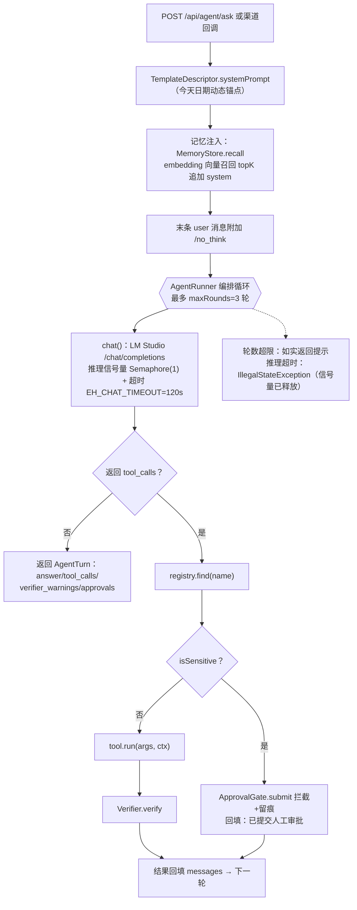
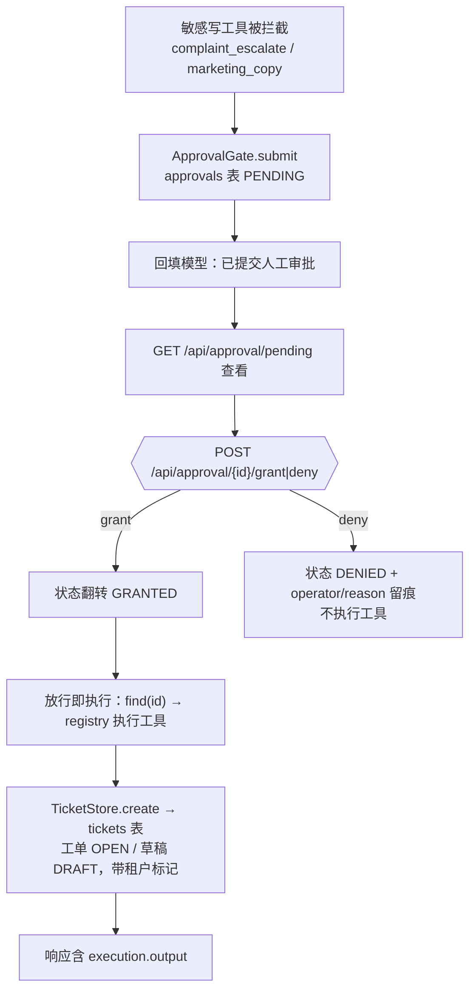
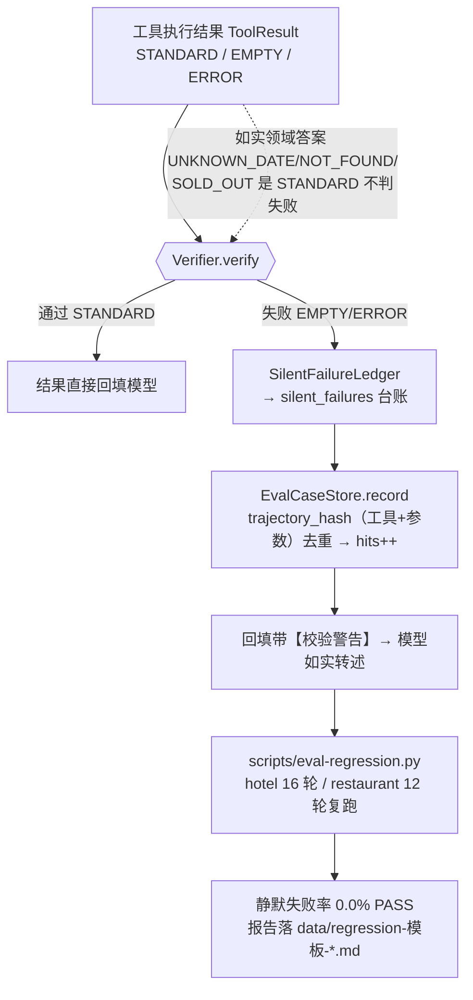
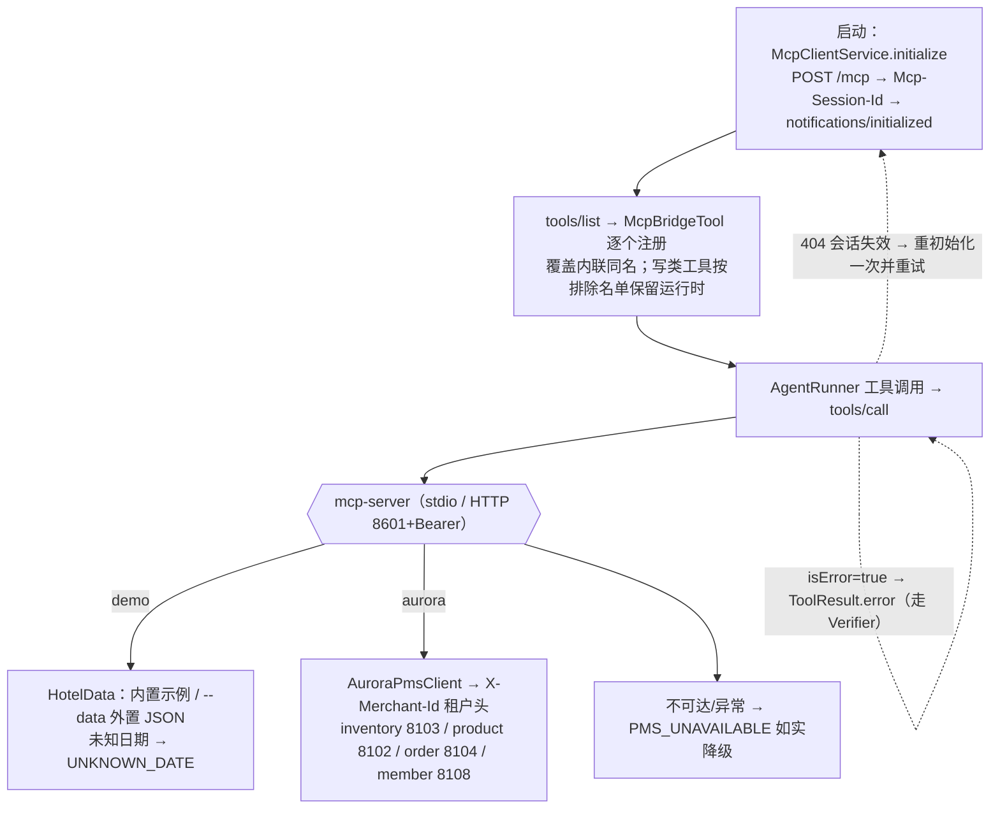
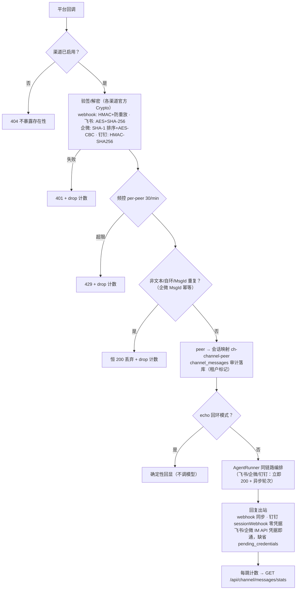
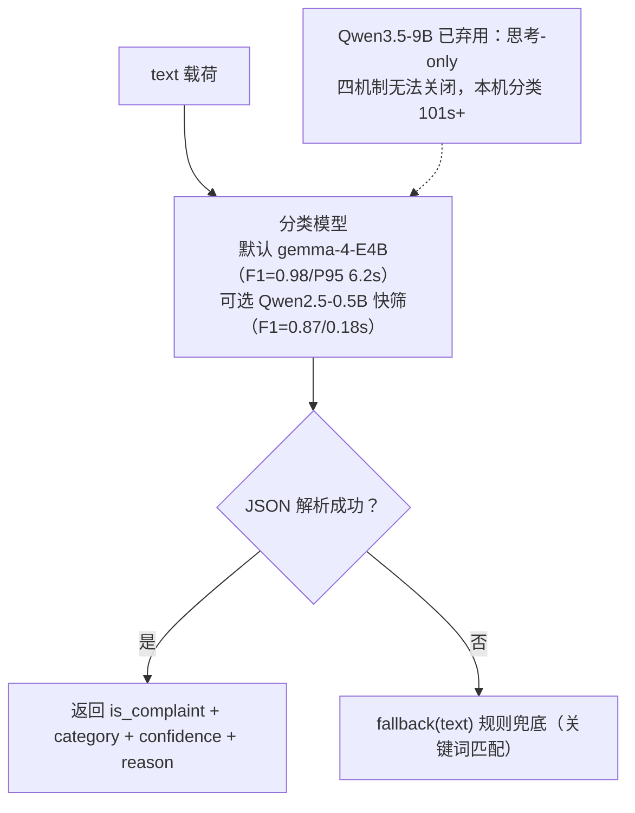
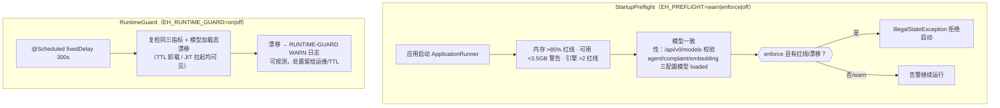
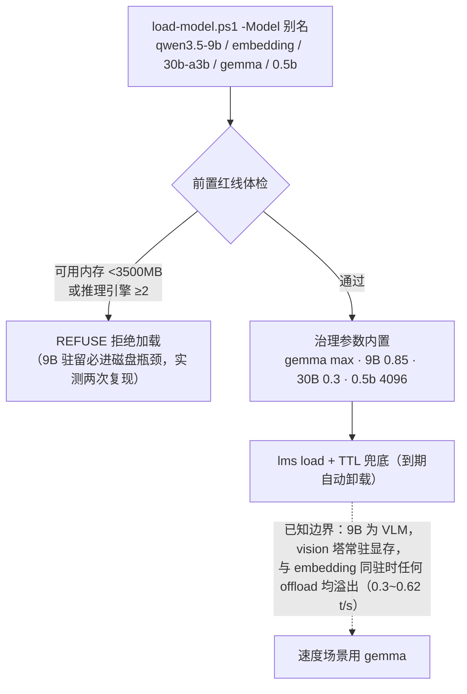
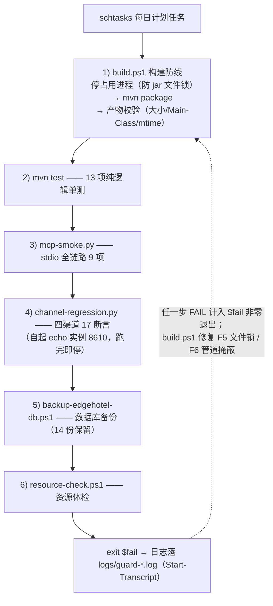

# EdgeHotel-Agent 流程图集（2026-10-30）

> 全部流程与代码实态一致（提交 `138f9d9` 时点）。交互式版本见控制台/会话内可视化；本文为随仓库版本管理的 Mermaid 源。
> 配套文档：[项目进展报告](项目进展报告-2026-10-30.md) · [README](../README.md) · mcp-server/README

## 1. 端到端问答编排（POST /api/agent/ask 与渠道共用链路）

## 2. 审批门闭环（写类工具 100% 留痕）

## 3. 静默失败治理（Verifier → 台账 → 回归）

## 4. MCP 数据源模式（EH_MCP_ENABLED=true）

## 5. 渠道消息统一流（webhook / 飞书 / 企微 / 钉钉）

## 6. 投诉识别（POST /api/complaint/detect）

## 7. 双层防线（启动 + 运行时）

## 8. 模型加载防线（scripts/load-model.ps1）

## 9. 部署与每日守卫（scripts/nightly-guard.ps1）

---

## 附：主机端口与红线速查

| 项 | 值 |
|---|---|
| 主应用 / MCP Server / aurora 网关 | 8600 / 8601 / 8100（服务 8102-8108） |
| 推理引擎上限 | 2（日常 1） |
| 内存红线 | 使用率 >85% 或可用 <3.5GB |
| chat 超时 | EH_CHAT_TIMEOUT=120s（单轮） |
| 频控 | per-peer 30/min（EH_CHANNEL_RATE_LIMIT） |
| 守卫间隔 | RuntimeGuard 300s / 计划任务每日 |
